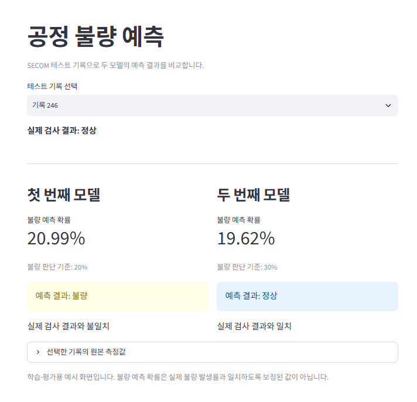
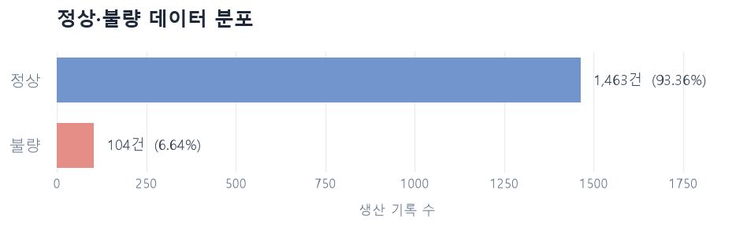
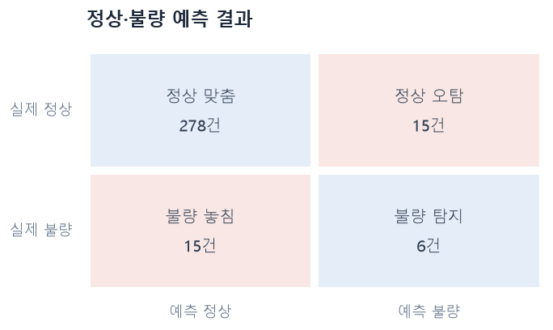

# 반도체 공정 불량 예측

> 공개 SECOM 공정 데이터를 활용한 불량 예측 모델 학습·평가 및 결과 시각화 프로젝트

## 프로젝트 개요

| 구분 | 내용 |
| --- | --- |
| 개발 형태 | 개인 프로젝트 |
| 개발 기간 | 2026.10 |
| 데이터 | UCI SECOM 공개 반도체 공정 데이터 |
| 데이터 처리 | Python, pandas, NumPy |
| 모델 학습 | scikit-learn, 로지스틱 회귀, Random Forest |
| 시각화 | Matplotlib, Seaborn |
| 결과 화면 | Streamlit |
| 구현 범위 | 데이터 확인, 전처리, 모델 학습·비교, 개선 실험, 테스트 평가, 예측 결과 표시 |

## 프로젝트 소개

공정 측정값을 활용한 불량 예측에서는 모델 학습뿐 아니라 결측치 처리, 정상·불량 불균형 확인, 오예측 분석이 필요합니다.

이 프로젝트는 공개 SECOM 데이터를 활용하여 정상·불량을 예측하는 모델을 학습하고, 평가 결과와 기록별 예측을 확인할 수 있도록 구성한 프로젝트입니다.

로지스틱 회귀와 Random Forest를 비교한 뒤 모델 설정과 판단 기준을 변경하는 실험을 진행했습니다. 측정 항목 수를 줄이는 실험도 수행하고, 검증 결과를 기준으로 모델을 선택했습니다.

저장한 두 모델을 같은 테스트 데이터에서 재평가하고, Streamlit 화면에서 예측 결과·불량 예측 확률·실제 검사 결과를 함께 확인하도록 구현했습니다.

## 주요 기능

### 1. 공정 데이터 확인

- 원본 측정값과 검사 결과 읽기 및 정상·불량 정답 변환
- 정상·불량 개수와 비율 확인 및 막대그래프 표시
- 결측치 개수·비율과 값이 일정한 측정 항목 확인

### 2. 학습 데이터 기준 전처리

- 정상·불량 비율을 유지하여 학습·검증·테스트 데이터 분리
- 학습 데이터에서 결측치가 많거나 관측값이 한 종류 이하인 항목 제외
- 학습 데이터의 중앙값으로 결측치 처리
- 로지스틱 회귀를 위한 측정값 표준화

### 3. 모델 학습 및 개선 실험

- 로지스틱 회귀와 기본 Random Forest 학습·검증
- 불량 판단 기준별 Precision·Recall·F1 및 오예측 건수 비교
- Random Forest 최대 깊이·리프 노드 최소 샘플 수 변경 실험
- 항목 중요도를 기준으로 측정 항목 수 축소 실험
- 검증 결과로 선택한 모델과 전처리 정보 저장

### 4. 테스트 평가 및 오류 확인

- 저장한 두 모델을 같은 테스트 데이터에서 평가
- 혼동행렬 표와 그래프 표시
- 불량을 정상으로 놓친 기록과 정상 오탐 기록 조회
- 두 모델의 성능과 오류 건수 비교

### 5. 예측 결과 화면

- 테스트 기록 번호를 오름차순으로 선택
- 두 모델의 정상·불량 예측 결과와 불량 예측 확률 표시
- 모델별 판단 기준과 실제 정답 일치 여부 표시
- 선택한 기록의 원본 측정값 조회

## 주요 화면

### 공정 불량 예측 비교

테스트 기록을 선택하면 두 모델의 예측 결과와 실제 검사 결과를 함께 표시합니다. 각 모델의 판단 기준과 불량 예측 확률을 확인하고, 원본 측정값을 펼쳐 조회할 수 있습니다.



### 정상·불량 데이터 분포

정상과 불량의 개수 및 비율을 막대그래프로 표시하여 데이터 불균형을 확인합니다.



### 혼동행렬

실제 정답과 예측 결과를 비교하여 정상 맞춤, 정상 오탐, 불량 놓침, 불량 탐지 건수를 표시합니다. 올바른 예측과 잘못된 예측을 색으로 구분합니다.



## 데이터 처리 흐름

### 모델 학습 및 평가

1. 원본 측정값과 검사 결과를 읽습니다.
2. 검사 결과를 정상 0, 불량 1로 변환합니다.
3. 데이터를 학습·검증·테스트로 분리합니다.
4. 학습 데이터에서 항목 선택과 결측치 처리·표준화 기준을 계산합니다.
5. 학습 데이터로 모델을 학습합니다.
6. 검증 데이터에서 모델 설정과 판단 기준을 비교합니다.
7. 모델과 전처리 정보, 판단 기준 및 테스트 행 번호를 저장합니다.
8. 저장한 모델로 테스트 데이터를 재평가하고 오류 기록을 확인합니다.

### 화면에서 기록별 예측

1. 사용자가 테스트 기록을 선택합니다.
2. 각 모델에 저장된 측정 항목과 전처리 기준을 적용합니다.
3. 모델이 불량 예측 확률을 계산합니다.
4. 저장된 판단 기준으로 정상·불량을 구분합니다.
5. 두 모델의 예측 결과와 실제 검사 결과를 화면에 표시합니다.

## 주요 구현 내용

### 데이터 불균형을 고려한 평가

전체 1,567건 중 정상은 1,463건, 불량은 104건으로 불량 비율은 약 6.64%입니다. 모두 정상으로 예측해도 정확도가 약 93.36%이므로, 정확도만으로 모델 성능을 판단하지 않았습니다.

불량 Precision·Recall·F1과 혼동행렬을 함께 확인하고, 특히 불량을 정상으로 놓친 건수와 정상 오탐 건수를 비교했습니다. 두 모델의 학습에는 `class_weight="balanced"`를 적용했습니다.

### 학습 데이터 기준 전처리

정상·불량 비율을 유지하는 무작위 분할로 학습 939건, 검증 314건, 테스트 314건을 구성했습니다. 난수 기준은 `42`로 고정했습니다.

학습 데이터에서 결측치 비율이 50%를 초과하거나 관측값이 한 종류 이하인 항목을 제외하여 590개 중 444개를 사용했습니다. 학습 데이터의 중앙값을 검증·테스트에도 적용하고, 로지스틱 회귀의 표준화 기준도 학습 데이터에서 계산했습니다.

검사 결과와 검사 시각은 모델 입력에 포함하지 않았습니다.

### Random Forest 설정과 판단 기준 비교

트리 수 200개를 유지하면서 최대 깊이 `제한 없음·5·10`, 리프 노드 최소 샘플 수 `2·5·10`의 9개 설정을 비교했습니다. 각 설정에 판단 기준 `0.1~0.5`를 적용했습니다.

검증 F1을 기준으로 모델을 선택하고, 동률이면 Recall과 Precision을 차례로 비교했습니다. 첫 번째 모델은 기본 Random Forest와 기준 0.2, 두 번째 모델은 최대 깊이 10인 Random Forest와 기준 0.3으로 구성했습니다.

| 구분 | 첫 번째 모델 | 두 번째 모델 |
| --- | --- | --- |
| 최대 깊이 | 제한 없음 | 10 |
| 리프 노드 최소 샘플 수 | 2 | 2 |
| 불량 판단 기준 | 0.2 | 0.3 |
| 측정 항목 수 | 444개 | 444개 |
| 검증 불량 F1 | 0.2000 | 0.2353 |

### 측정 항목 축소 실험

학습 데이터로 학습한 기본 Random Forest의 중요도를 기준으로 상위 50개·100개·200개 항목을 선택하여 전체 444개를 사용하는 경우와 비교했습니다. 항목 수의 영향을 확인하기 위해 기본 모델 설정과 판단 기준 0.2를 유지했습니다.

100개 항목의 검증 F1은 0.2056으로 소폭 상승했지만 정상 오탐도 늘었습니다. 두 번째 모델의 검증 F1보다 낮아 최종 모델에는 항목 축소를 적용하지 않았습니다.

### 모델 저장과 예측 화면 연결

모델, 결측치 처리 도구, 표준화 도구, 측정 항목 및 판단 기준을 joblib 파일로 함께 저장했습니다. 테스트 행 번호도 저장하여 평가와 화면에서 같은 기록을 사용할 수 있도록 구성했습니다.

첫 번째·두 번째 모델을 별도 파일로 저장하고, Streamlit에서 각 모델의 전처리를 적용한 뒤 기록별 예측 결과를 나란히 표시했습니다.

## 모델 평가 결과

같은 테스트 데이터 314건(정상 293건·불량 21건)에 두 모델의 저장된 판단 기준을 적용한 재평가 결과입니다.

| 지표 | 첫 번째 모델 | 두 번째 모델 |
| --- | ---: | ---: |
| 정확도 | 84.71% | 90.45% |
| 불량 Precision | 25.45% | 28.57% |
| 불량 Recall | 66.67% | 28.57% |
| 불량 F1 | 0.3684 | 0.2857 |
| 불량 탐지 | 14건 | 6건 |
| 불량 놓침 | 7건 | 15건 |
| 정상 오탐 | 41건 | 15건 |

두 번째 모델은 정상 오탐이 줄었지만 불량 놓침이 늘었고 테스트 F1도 낮아졌습니다. 검증 F1이 높은 설정이 테스트에서도 더 좋은 결과를 보이지는 않았습니다.

모델 설정과 판단 기준이 함께 달라졌으므로 결과 차이를 한 가지 변경만의 효과로 해석하지 않았습니다. 테스트 비교 결과로 모델이나 판단 기준을 다시 선택하지 않았습니다.

## 기술 스택

| 구분 | 기술 | 활용 내용 |
| --- | --- | --- |
| Language | Python | 데이터 처리, 모델 학습·평가 및 화면 구현 |
| Data | pandas, NumPy | 원본 데이터 조회·가공 및 배열 처리 |
| Machine Learning | scikit-learn | 데이터 분리, 전처리, 모델 학습 및 성능 평가 |
| Visualization | Matplotlib, Seaborn | 데이터 분포와 혼동행렬 시각화 |
| UI | Streamlit | 테스트 기록별 두 모델 예측 결과 표시 |
| Model Storage | joblib | 모델과 전처리 정보 저장·불러오기 |
| Tool | VS Code, Jupyter Notebook | 코드 작성 및 단계별 실험 |
| Version Control | Git, GitHub | 소스 및 실험 기록 관리 |

## 프로젝트 구조

| 경로 | 역할 |
| --- | --- |
| `data/raw/` | SECOM 원본 측정값·검사 결과·데이터 설명 |
| `notebooks/01_data_exploration.ipynb` | 데이터 분포·결측치 확인 |
| `notebooks/02_model_training.ipynb` | 전처리·모델 학습·개선 실험·저장 |
| `notebooks/03_model_evaluation.ipynb` | 테스트 재평가·오류 확인·모델 비교 |
| `models/defect_prediction_baseline.joblib` | 첫 번째 모델과 전처리 정보 |
| `models/defect_prediction.joblib` | 두 번째 모델과 전처리 정보 |
| `images/` | 예측 비교 화면·데이터 분포·혼동행렬 이미지 |
| `app.py` | 테스트 기록별 예측 비교 화면 |
| `requirements.txt` | 실행 환경의 패키지 및 버전 |
| `README.md` | 프로젝트 설명 및 실행 방법 |

## 실행 전 준비

데이터 출처: [UCI SECOM](https://archive.ics.uci.edu/dataset/179/secom)

다음 원본 파일을 프로젝트의 `data/raw` 폴더에 준비합니다.

- `secom.data`: 590개 항목의 공정 측정값
- `secom_labels.data`: 검사 결과와 검사 시각
- `secom.names`: 데이터 설명

측정 항목의 구체적인 의미가 공개되지 않아 임의로 온도·압력 등의 이름을 붙이지 않았습니다. 그래프의 한글 글꼴은 Windows의 맑은 고딕을 사용합니다.

## 실행 방법

### 1. Python 환경 준비

Windows PowerShell에서 프로젝트 최상위 폴더를 기준으로 실행합니다.

```powershell
python -m venv .venv
.\.venv\Scripts\Activate.ps1
python -m pip install -r requirements.txt
```

### 2. 노트북 실행

VS Code에서 `.venv` 커널을 선택한 뒤 다음 순서로 노트북을 실행합니다.

1. `01_data_exploration.ipynb`: 데이터 확인
2. `02_model_training.ipynb`: 모델 학습 및 두 모델 파일 생성
3. `03_model_evaluation.ipynb`: 테스트 재평가 및 비교

모델 파일을 다시 생성할 때는 저장된 모델과 같은 scikit-learn 버전을 사용하는 것이 재현에 도움이 됩니다. 사용 버전은 `requirements.txt`에 기록되어 있습니다.

### 3. 예측 화면 실행

두 모델 파일이 `models` 폴더에 준비된 상태에서 실행합니다.

```powershell
python -m streamlit run app.py
```

브라우저에서 테스트 기록을 선택하면 두 모델의 결과가 표시됩니다. 기록 번호는 원본 데이터의 행 번호이며, 테스트에 포함된 314개 기록만 오름차순으로 제공합니다.

## 구현 결과

- 원본 데이터 확인부터 전처리·학습·검증·테스트 평가까지 단계별 노트북 구성
- 모델 설정·판단 기준·측정 항목 수 변경 실험 및 결과 기록
- 불량 놓침과 정상 오탐을 구분하여 오류 사례 확인
- 두 모델과 전처리 정보를 별도 저장하여 평가 결과 재현
- 저장한 모델의 예측을 Streamlit 화면에 연결

## 한계

- 검증·테스트의 불량이 각각 21건으로 적고 같은 검증 데이터를 여러 후보 비교에 사용하여 선택 결과의 안정성을 보장하기 어렵습니다.
- 첫 번째 모델의 테스트 결과를 확인한 뒤 개선 실험을 추가했으므로 이후 결과는 같은 테스트 데이터의 재평가입니다.
- 무작위 분할 결과만으로 실제 공정이나 이후 시점에서의 성능을 보장할 수 없습니다.
- 측정 항목의 의미가 공개되지 않아 오예측의 공정 원인을 해석하는 데 한계가 있습니다.
- 불량 예측 확률은 실제 불량 발생률에 맞춰 보정하지 않았습니다.
- 화면은 기존 테스트 기록을 선택하는 방식이며 새 측정값의 직접 입력 기능은 구현하지 않았습니다.

공개 데이터를 활용한 학습·평가용 프로젝트이며, 실제 공정에서의 운영 성능은 검증하지 않았습니다.

## 향후 개선사항

- 전처리와 항목 선택을 각 학습 구간 안에서 수행하는 교차검증으로 결과 안정성 확인
- 검사 시각에 따른 데이터 분할로 이후 시점의 예측 성능 평가
- 불량 놓침과 정상 오탐 비용을 고려한 판단 기준 검토
- 다른 모델 및 전처리 방식 비교
- 새 측정값을 포함한 파일 입력 기능 추가
